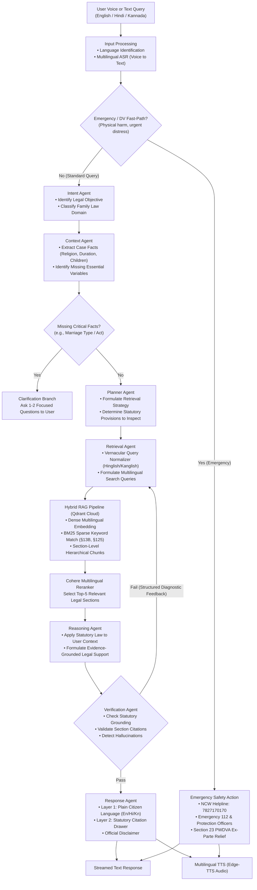

# Agent Forge: Enhanced Multilingual Agentic AI Legal Support System
## Finalized Architecture Specification & Implementation Plan

---

### 1. Executive Summary

**Agent Forge** is an enterprise-grade, multilingual agentic AI decision-support system specializing in Indian Family Law. It is architected for **voice-and-text interactions** in **English, Hindi, and Kannada**, incorporating strict legal grounding, self-correcting agent loops, and immediate safety protections.

The system integrates:
* **Orchestration**: **LangGraph** multi-agent state graph with checkpointed conversation memory (no external SQL database needed).
* **Vector Store**: **Qdrant Cloud** with **Hybrid Search** (Dense Multilingual Vectors + BM25 Sparse Keyword tokens for exact section numbers like §13B, §125).
* **Official Knowledge Base**: Government legal API key for official statutory act ingestion and live lookups.
* **Reranker**: **Cohere Multilingual Reranker** (`rerank-multilingual-v3.0`).
* **LLM Engine**: **Google Gemini** for intent classification, fact extraction, legal reasoning, and verification.
* **Voice Engine**: Multilingual **ASR** (Voice-to-Text) + **Edge-TTS** (Text-to-Speech in Hindi, Kannada, English) with token streaming.

---

### 2. Enhanced Architecture Flow

#### High-Level Flow Diagram (Mermaid)



#### ASCII Architecture Diagram

```text
==================================================================================================
                        USER VOICE / TEXT QUERY (English / Hindi / Kannada)
==================================================================================================
                                               │
                                               ▼
               [ Input Processing: Language ID + Multilingual ASR (Voice-to-Text) ]
                                               │
                                               ▼
                             < Emergency / Domestic Violence? >
                                     /                   \
                        (YES / Imminent Danger)      (NO / Standard Case)
                                   │                              │
                                   ▼                              ▼
                 [ Emergency Fast-Path ]                [ Intent Agent ]
                 • NCW Helpline: 7827170170             • Identify family law domain
                 • Emergency 112 / Sakhi                • Classify legal remedy
                 • Sec 23 PWDVA Interim Relief                    │
                                   │                              ▼
                                   │                    [ Context Agent ]
                                   │                    • Religion / Marriage Act
                                   │                    • Marriage duration & children
                                   │                              │
                                   │                     < Missing Critical Facts? >
                                   │                           /            \
                                   │                     (YES)              (NO)
                                   │                       │                  │
                                   │             [ Clarify Prompt ]   [ Planner Agent ]
                                   │             (Ask 1-2 questions)  • Formulate search plan
                                   │                                          │
                                   │                                          ▼
                                   │                    ┌───► [ Retrieval Agent ] ◄────────────────┐
                                   │                    │     • Hinglish/Kanglish Normalizer       │
                                   │                    │     • Dual Qdrant + Govt API Query       │
                                   │                    │                 │                        │
                                   │                    │                 ▼                        │
                                   │                    │     [ Hybrid RAG Pipeline ]              │
                                   │                    │     • Dense Vectors (Semantics)          │
                                   │                    │     • BM25 Sparse (§13B, §125, etc.)     │
                                   │                    │                 │                        │
                                   │                    │                 ▼                        │
                                   │                    │     [ Cohere Multilingual Rerank ]       │
                                   │                    │     (Top-5 statutory passages)           │
                                   │                    │                 │                        │
                                   │                    │                 ▼                        │
                                   │                    │     [ Reasoning Agent ]                  │
                                   │                    │     • Apply statutes to case facts       │
                                   │                    │                 │                        │
                                   │                    │                 ▼                        │
                                   │                    │     < Verification Agent >               │
                                   │                    │     • Grounding & citation check         │
                                   │                    │           /                 \            │
                                   │                    └─ (FAIL: Retry < 2)     (PASS)            │
                                   │                                                │              │
                                   │                                                ▼              │
                                   │                                      [ Response Agent ]       │
                                   │                                      • Layer 1: Plain Citizen │
                                   │                                      • Layer 2: Legal Drawer  │
                                   │                                                │              │
                                   └──────────────────────────────┬─────────────────┘              │
                                                                  ▼                                │
                                               ┌──────────────────────────────────┐                │
                                               │ Text Response + Edge-TTS Audio   │                │
                                               └──────────────────────────────────┘                │
```

---

### 3. Detailed Component & Agent Specifications

#### 1. Input Processing & Emergency Fast-Path
* **Language Identification (LID):** Detects `en`, `hi`, `kn`.
* **Multilingual ASR:** Ingests microphone audio and transcribes code-mixed Indian vernacular (Hinglish/Kanglish).
* **Safety Gatekeeper (Red-Flag Detector):** If the input indicates physical violence, threats to life, or forcible eviction:
  - Immediately prepends emergency contacts: **National Commission for Women (NCW) Helpline `7827170170`** and **Emergency `112`**.
  - Highlights statutory immediate remedies under **Section 12, 17 (Right to reside in shared household), and Section 23 (Ex-parte interim protection orders)** of the *Protection of Women from Domestic Violence Act, 2005 (PWDVA)*.

#### 2. Intent & Context Agents (with Active Clarification)
* **Intent Agent:** Classifies into sub-domains:
  - Divorce by Mutual Consent vs Contested Grounds
  - Maintenance & Alimony (BNSS §144 / CrPC §125, HMA §24/§25, PWDVA §20)
  - Child Custody & Visitation (Guardians and Wards Act 1890, HMGA 1956)
  - Domestic Violence Relief (PWDVA 2005)
  - Restitution of Conjugal Rights (HMA §9, SMA §22)
* **Context Agent & Missing Variable Checker:**
  - Evaluates whether essential legal facts are present:
    - *Religion / Applicable Statute* (Hindu/Buddhist/Jain/Sikh, Muslim, Christian, Civil/Special Marriage Act)
    - *Duration of Marriage* (e.g. check for 1-year waiting period under HMA §14)
    - *Minor Children & Custody Status*
  - **Clarification Branch:** If critical facts are absent, instead of making assumptions, the system politely prompts the user with 1–2 specific multiple-choice/written questions.

#### 3. Retrieval Agent & Vernacular Normalization
* **Vernacular Normalizer:** Translates code-mixed queries (e.g., *"Mera husband maintenance nahi de raha hai, 6 months se alag reh rahe hain"*) into standardized statutory English search terms (*"maintenance under Section 144 BNSS / Section 125 CrPC separation"*).
* Preserves the user's original language preference so the final response is in their spoken tongue.

#### 4. Hybrid Qdrant Vector Store & Cohere Reranking
* **Section-Level Hierarchical Chunking:** Statutes are segmented by `Act` $\rightarrow$ `Chapter` $\rightarrow$ `Section` $\rightarrow$ `Sub-section` $\rightarrow$ `Proviso/Explanation`, preserving full legal context.
* **Hybrid Search (Dense + BM25):**
  - Dense embeddings capture conceptual meaning.
  - BM25 sparse keyword matching guarantees retrieval when exact numbers are mentioned (*"Section 13B"*, *"Section 24"*, *"Section 125"*, *"Section 498A"*).
* **Cohere Multilingual Reranker (`rerank-multilingual-v3.0`):**
  - Reranks top 20 candidate sections down to the 5 most relevant statutory provisions.

#### 5. Reasoning Agent
* Combines retrieved statutory evidence with the user's specific context.
* Formulates:
  - Applicable legal provisions and statutory rights.
  - Required procedural steps (where to file, competent court, necessary documentation).
  - Practical caveats (cooling-off periods, mediation requirements, limitation rules).

#### 6. Verification Agent with Structured Diagnostic Loop
* **Safety & Grounding Check:**
  - Verifies that all cited sections exist in the retrieved passages.
  - Detects any fabricated legal claims or hallucinated precedents.
* **Structured Diagnostic Output on Failure:**
  ```python
  class VerificationResult(BaseModel):
      passed: bool
      missing_evidence: list[str]       # Specific missing statutory conditions
      unsupported_claims: list[str]     # Statements lacking grounding
      revised_search_query: str         # Targeted search terms for re-querying
      retry_count: int
  ```
* **Loop Control:**
  - If `passed == False` and `retry_count < 2`: Routes back to the **Retrieval Agent** with `revised_search_query`.
  - If `retry_count >= 2`: Gracefully forwards to the Response Agent with an explicit legal aid advisory (DLSA / Family Court Legal Services Committee).
  - If `passed == True`: Advances to the **Response Agent**.

#### 7. Two-Layer Response Agent & Multilingual Voice
* **Layer 1: Plain Citizen Language:** Compassionate, jargon-free explanation delivered in **English, Hindi, or Kannada**.
* **Layer 2: Statutory Citation Drawer:** Collapsible references showing exact Act names, Section numbers, and official government text.
* **Multilingual TTS Engine (Edge-TTS):**
  - English: `en-IN-NeerjaNeural`
  - Hindi: `hi-IN-SwaraNeural`
  - Kannada: `kn-IN-GaganNeural`
  - High-fidelity natural voice synthesis without external API fees.

---

### 4. Implementation Roadmap

| Step | Component | Key Deliverables |
|---|---|---|
| **Step 1** | **Backend Scaffolding & Setup** | Project directories, `requirements.txt`, `.env.example`, FastAPI configuration. |
| **Step 2** | **Qdrant Hybrid Search & Ingestion** | Section-level statutory chunker, Qdrant collection setup with Dense + BM25 hybrid search, ingestion of core Family Law acts. |
| **Step 3** | **Cohere Reranker Integration** | `rerank-multilingual-v3.0` setup with candidate scoring and filtering. |
| **Step 4** | **Multi-Agent LangGraph Workflow** | Implementation of: Safety Gatekeeper, Intent Agent, Context Agent (with Clarification check), Planner Agent, Retrieval Agent (with Vernacular Normalizer), Reasoning Agent, Verification Agent (with Diagnostic feedback loop), and Response Agent. |
| **Step 5** | **Multilingual Voice Engine** | Speech-to-Text ASR endpoint + Edge-TTS streaming audio synthesizer in En, Hi, Kn. |
| **Step 6** | **Frontend Application** | Modern conversational Web UI with microphone recording, real-time waveform, collapsible Citations Drawer, and Language Switcher. |
| **Step 7** | **Benchmarking & Validation** | Test against landmark Indian Family Law scenarios across all 3 languages. |
