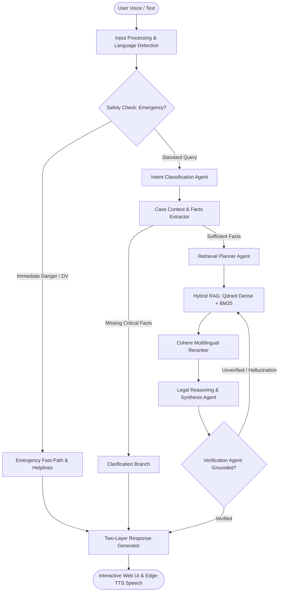

# Agent Forge — Multilingual Indian Family Law Support System

An Agentic AI decision-support platform designed to provide accessible, plain-language guidance on Indian Family Law to citizens in **10 major Indian languages** (English, हिन्दी, ಕನ್ನಡ, తెలుగు, தமிழ், বাংলা, मराठी, ગુજરાતી, മലയാളം, اردو) through both voice and text interactions.

---

## 🏛️ System Architecture

Agent Forge uses a verified multi-agent pipeline orchestrated with **LangGraph**, **Google Gemini**, **Qdrant Vector Database**, **Cohere Multilingual Reranker**, and **Microsoft Edge-TTS**:



---

## ✨ Key Capabilities

1. **Two-Layer Structured Responses**:
   - **Layer 1 (Citizen-Friendly)**: Empathetic, jargon-free explanations in the citizen's native language.
   - **Layer 2 (Statutory Citations)**: Grounded section numbers, act names, and direct links to India Code / Indian Kanoon.
2. **10 Supported Indian Languages**:
   - English (`en`), Hindi (`hi`), Kannada (`kn`), Telugu (`te`), Tamil (`ta`), Bengali (`bn`), Marathi (`mr`), Gujarati (`gu`), Malayalam (`ml`), Urdu (`ur`).
   - Dynamic real-time script detection and phonetically accurate Text-to-Speech pronunciation.
3. **Safety & Emergency Fast-Path**:
   - Instant domestic violence detection with 24/7 helplines (NCW `7827170170`, General Emergency `112`, DLSA `15100`).
4. **Self-Correcting Multi-Agent Verification**:
   - Hallucination prevention loop where the Verification Agent audits legal claims against retrieved statutory texts before delivery.
5. **Full Speech Pipeline**:
   - Multilingual voice input transcription (ASR) via Gemini Multimodal.
   - Zero-latency, crystal-clear speech synthesis (TTS) via Microsoft Edge-TTS neural voices.

---

## 📁 Repository Structure

```
.
├── backend/
│   ├── app/
│   │   ├── agents/          # LangGraph agents (Intent, Context, Planner, Retrieval, Reasoning, Verifier, Response)
│   │   ├── api/             # FastAPI routes (chat, audio, health)
│   │   ├── core/            # Configuration and state schemas
│   │   ├── rag/             # Qdrant client, Cohere reranker, India Code API
│   │   ├── speech/          # ASR transcription & Edge-TTS synthesis
│   │   ├── graph.py         # Compiled LangGraph workflow
│   │   └── main.py          # FastAPI application entrypoint
│   ├── data/raw_acts/       # Statutory family law texts (HMA, SMA, PWDVA, etc.)
│   ├── scripts/             # Qdrant ingestion and indexing scripts
│   ├── .env.example         # Template for environment variables
│   └── requirements.txt     # Python backend dependencies
├── frontend/
│   ├── src/
│   │   ├── components/      # React components (ChatInterface, CitationDrawer, VoiceRecorder, etc.)
│   │   ├── styles/          # Executive dark theme styling
│   │   ├── utils/           # API fetch and SSE streaming handlers
│   │   ├── App.jsx          # Root application component
│   │   └── main.jsx         # React DOM mounting
│   ├── index.html
│   ├── package.json         # Frontend dependencies (React 18, Vite, Lucide)
│   └── vite.config.js       # Vite build & reverse-proxy configuration
├── .gitignore               # Strict exclusion of secrets, logs, audio blobs, and build artifacts
├── start_all.ps1            # One-click Windows PowerShell full-stack launcher
├── start_backend.ps1        # Backend launcher script
└── start_frontend.ps1       # Frontend launcher script
```

---

## 🚀 Quick Start Guide

### 1. Prerequisites
- **Python**: Version 3.10 or higher
- **Node.js**: Version 18.x or higher
- API Keys:
  - [Google Gemini API Key](https://aistudio.google.com/app/apikey)
  - [Cohere API Key](https://dashboard.cohere.com/api-keys)
  - [Qdrant Cloud Cluster](https://cloud.qdrant.io/)

### 2. Environment Setup
1. Copy the environment configuration template:
   ```bash
   cp backend/.env.example backend/.env
   ```
2. Open `backend/.env` and insert your credentials:
   ```env
   GEMINI_API_KEY=your_gemini_api_key_here
   COHERE_API_KEY=your_cohere_api_key_here
   QDRANT_URL=https://your-cluster-url.qdrant.io
   QDRANT_API_KEY=your_qdrant_api_key_here
   ```

### 3. Backend Setup
```bash
cd backend
python -m pip install -r requirements.txt
python -m uvicorn app.main:app --host 0.0.0.0 --port 8000 --reload
```
- API Documentation is live at: `http://localhost:8000/docs`

### 4. Frontend Setup
```bash
cd frontend
npm install
npm run dev
```
- Web Application is live at: `http://localhost:5173`

---

## 🔒 Security & Privacy
- **Credentials Protection**: `backend/.env` is excluded in `.gitignore` and must never be committed.
- **Statutory Accuracy**: All legal advice is verified against official statutes before being served.
- **Educational Disclaimer**: This system provides legal information and decision support, not certified legal representation.

